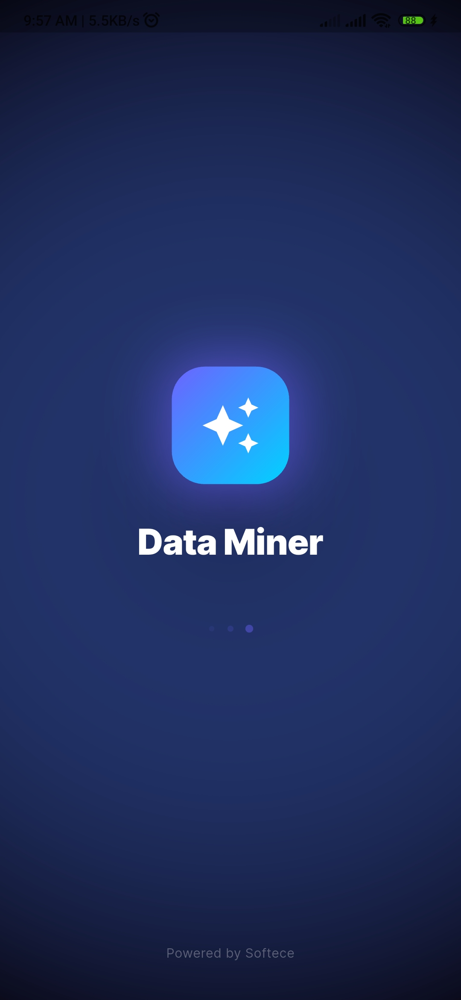
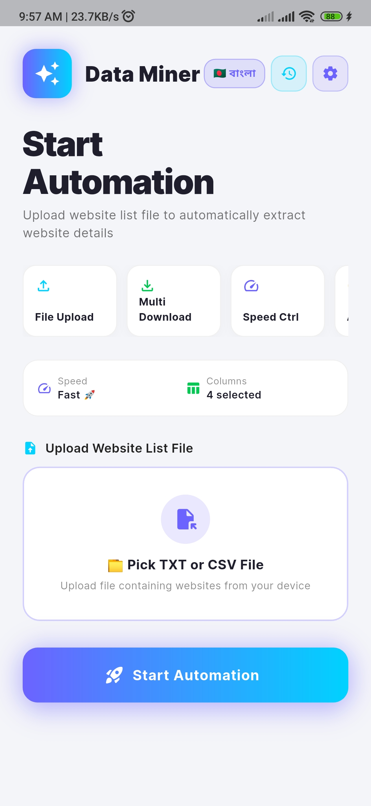
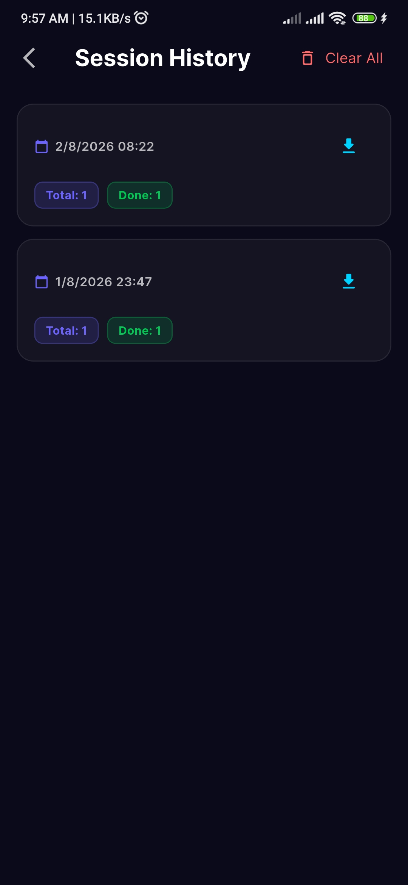
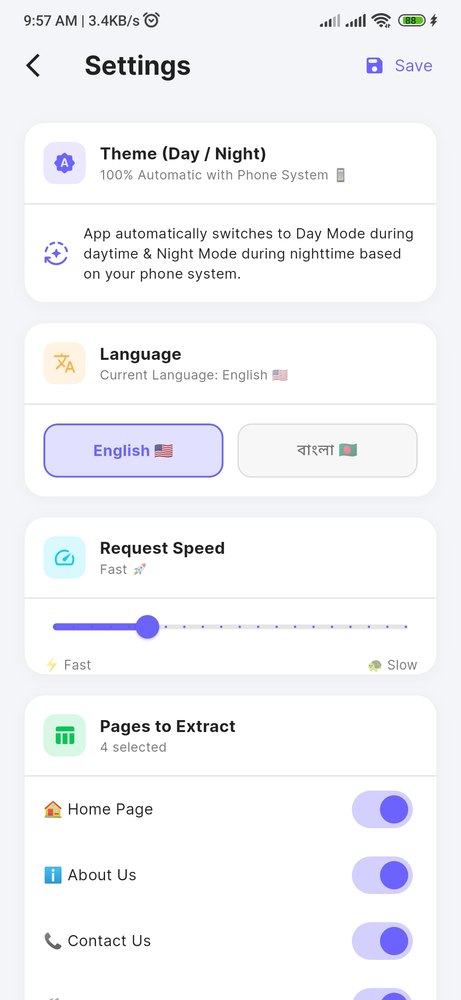
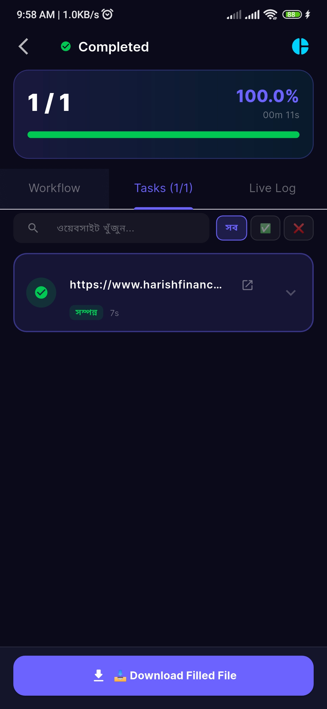
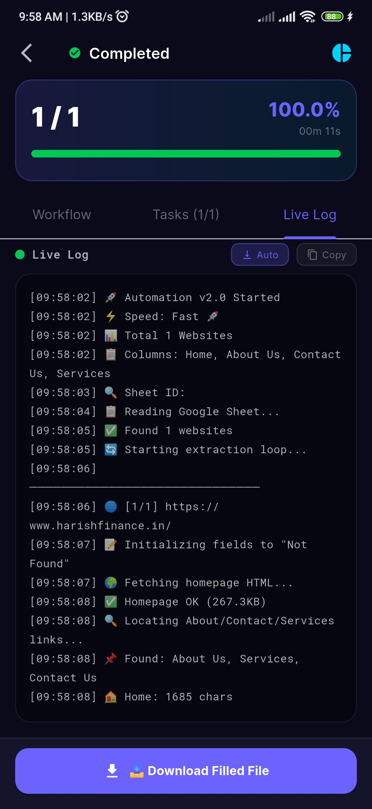
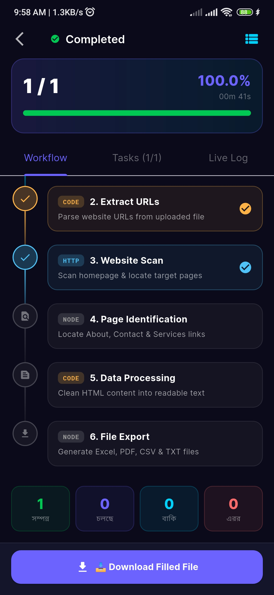
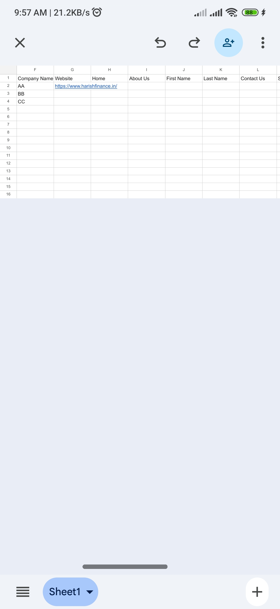
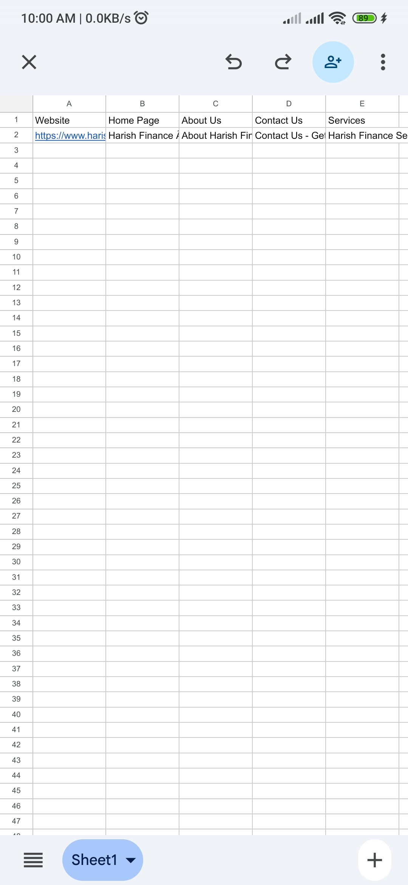

<div align="center">

# 🕸️ Website Data Miner
### **"Automation Made Simple - Extract Data at Scale"**

[](https://flutter.dev/)
[](https://dart.dev/)
[](https://github.com/fuadk/Data-Miner)
[](LICENSE)

**An advanced Flutter-based automation tool for mining data from websites using customizable parameters.**

---

</div>

---

## 📖 Overview
**Website Data Miner** is a powerful utility designed for researchers and data analysts to automate the process of visiting websites and extracting specific information. It supports bulk processing via TXT or CSV files, provides real-time progress tracking, and offers a highly customizable extraction engine.

---

## 🖼️ App Screenshot Gallery

### 🏠 Home & Configuration
*The starting point for your mining sessions. Upload your website lists and customize extraction parameters.*

<div align="center">
  
  
  
</div>

### 📊 Smart Data Mining & Progress
*Real-time automation tracking with interactive charts and live progress indicators.*

<div align="center">
  
  
  
</div>

### 📂 History & Data Insights
*Review your previous mining sessions and export results to multiple formats.*

<div align="center">
  
  
</div>

### ⚙️ Customization & Themes
*Full control over app behavior, multi-language support, and seamless dark mode.*

<div align="center">
  
  
</div>

---

## ✨ Key Features

- 📁 **Bulk Import:** Support for loading large lists of websites from `.txt` and `.csv` files.
- ⚙️ **Customizable Extraction:** Select specific data columns to extract (Emails, Social Links, Meta Data, etc.).
- 📊 **Real-time Tracking:** Monitor automation progress with detailed charts and progress bars.
- 🌓 **Dynamic Themes:** 100% automatic Day/Night mode support based on system settings.
- 🌐 **Multi-language Support:** Full localization for both English and Bangla (বাংলা).
- 📂 **Export Options:** Save mined data to Excel, CSV, or PDF formats.

---

## 🛠️ Tech Stack

| Layer | Technology |
| :--- | :--- |
| **Framework** | Flutter (Dart) |
| **State Management** | Custom Controllers / Service-based |
| **Storage** | Shared Preferences |
| **Visualization** | FL Chart, Percent Indicator |
| **Animations** | Lottie, Flutter Animate |
| **Fonts** | Google Fonts (Inter) |

---

## 📁 Project Structure

```text
Data-Miner/
├── lib/
│   ├── controllers/    # Business logic & Automation handling
│   ├── models/         # Data structures & Settings models
│   ├── screens/        # UI Layers (Home, Automation, Settings, etc.)
│   ├── services/       # Exporting & Persistence services
│   ├── widgets/        # Reusable UI components
│   └── main.dart       # App entry point
├── Photos/             # App screenshots and assets
├── pubspec.yaml        # Dependencies & Configuration
└── README.md           # Project documentation
```

---

## 📄 License

Distributed under the MIT License. See `LICENSE` for more information.

<p align="center">
  Developed with ❤️ by <b> Fuad</b><br>
  <i>Website Data Miner</i>
</p>
